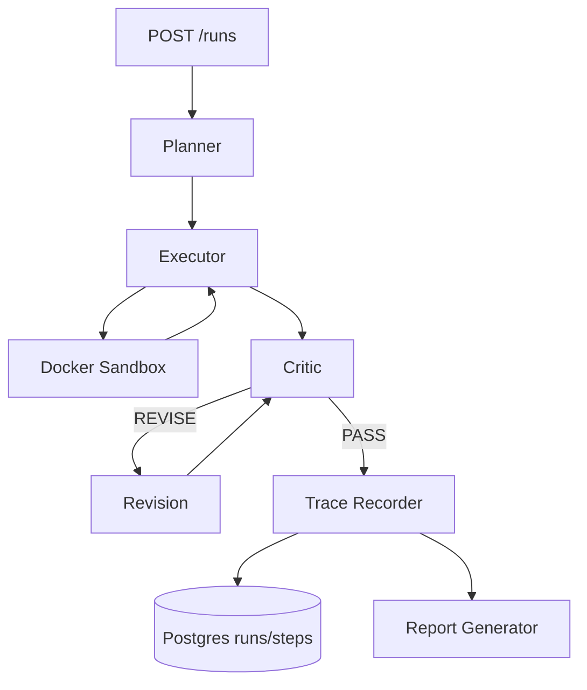

# Architecture

Agent Forge is a single pipeline with one entry point. A task goes in through the API,
the planner decomposes it, the executor runs each step (tools included), the critic
score-checks the result in a bounded loop, and every step is recorded to a trace
that feeds the report generator. There is no hidden state between runs: Postgres
stores traces, `data/artifacts/` stores files, and the scratchpad is rebuilt from
the plan each run.

## Orchestrator (API)

`apps/api/main.py` is a FastAPI service on port 8000. It owns the run lifecycle:
`POST /runs` accepts `{"task", "provider"?, "model"?}`, drives
`create_plan -> execute_step (per step) -> critique loop`, then persists the run.
The other routes:

- `GET /runs?limit=50` - run list with total cost, duration, step count
- `GET /runs/{run_id}` - full run: steps in order (by `seq`), `final_output`
- `GET /artifacts/{run_id}/{name}` - serves bytes from `data/artifacts/` (path traversal guarded)
- `GET /config` - available providers, models, which API keys are set
- `GET /health` - provider/model currently configured

The pipeline runs in-process, one task at a time per request. `provider`/`model`
override the `LLM_PROVIDER`/`LLM_MODEL` env defaults so you can replay a task on a
different model without re-planning. There is no authentication; the service is
meant to run on localhost. Postgres is the trace store (`runs` + `steps` tables,
seeded by `infra/postgres/init.sql`). Artifact bytes in the trace are base64;
the orchestrator decodes them to `ARTIFACT_DIR/<run_id>/` after each run.

## Planner

`packages/agent_core/planner.py`. The planner is one structured LLM call that must
return a `Plan`: 3-5 `SubTask`s, each with `id` (`s1..s5`), `description`, optional
`tool` (`http_fetch | code_execution | sql_query | web_search`, `None` = pure
reasoning), and `depends_on` (step DAG). `validate_plan` enforces unique ids, valid
dependency refs, and no cycles (DFS). If the plan is structurally invalid, the
planner retries once, feeding the validation error back to the model; tokens and
cost from both calls are summed into the trace metadata.

The system prompt encodes one hard rule: keep network and code separated.
`code_execution` can never reach the internet, so any step whose code needs
external data must depend on an earlier `http_fetch`/`web_search` step; the
dependency's output file is then mounted read-only into the sandbox.

## Executor

`packages/agent_core/executor.py`. `execute_step` runs one subtask and never raises
on tool failure - failures are returned so the critic can route a retry. It builds
tool arguments differently per tool:

- `http_fetch` - a structured LLM call extracts the single URL
- `web_search` - extracts a query, sends `{"query", "max_results": 5}`
- `sql_query` - extracts one read-only SQL statement
- `code_execution` - an LLM call writes the Python script; dependency outputs are
  mounted as input files (`/in/<dep>.json` for tool outputs, `/in/<dep>.txt` for
  reasoning text)

Each step result is written to the scratchpad under the step id; tool outputs are
kept under `_tool_output_<id>` and failures under `_tool_failures` so a later
critic pass can direct a retry. Large base64 artifact blobs are stripped from the
LLM context (name/size/truncated only) before the summary call.

## Critic

`packages/agent_core/critic.py`. The critic is a structured LLM call that returns
`{"verdict": "PASS" | "REVISE", "feedback", "score"}`. The orchestrator loops up
to `MAX_REVISIONS` (env, default 3): on `REVISE` it runs one revision pass and nests
that step under the critique step via `parent_step_id`. When the loop is exhausted
the run still ends `succeeded` with the last revision - so a run that passes only
by hitting the cap looks identical to a clean pass unless you read the trace.
`docs/design-decisions.md` (ADR-003) is where this is justified.

## Tool Registry

`packages/tools/registry.py` is a plain dict mapping tool name to async function:
`http_fetch`, `code_execution`, `sql_query`, `web_search`. The executor looks up
`subtask.tool` in it; an unknown tool name produces an `{"error": ...}` result, not
an exception. Every tool returns a plain dict and signals failure with a top-level
`error` key. See `docs/tools.md` for schemas, examples, and limits per tool.

## Sandbox Manager

`packages/sandbox/manager.py` plus `infra/sandbox-image/`. One throwaway Docker
container per `code_execution` call: no network, read-only root, 512m RAM, 0.5 CPU,
30s wall-clock, `/in` and the script mounted read-only, `/out` mounted read-write.
Artifacts in `/out` are collected, base64-inlined into the result (with size caps),
and the container is destroyed even on timeout. The image ships pandas, numpy,
matplotlib, and a non-root user. Full flag-by-flag rationale in
`docs/sandbox.md`.

## Trace Recorder

Two schema layers coexist:

- Runtime trace: `packages/trace/src/trace/schemas.py` (`TraceRun`, `TraceStep`).
  Step types: `plan | tool_call | llm_call | critique | revision`. Every step
  carries `tokens {in,out}`, `cost_usd`, `latency_ms`, and `parent_step_id` for the
  plan/revision tree. The API writes these to Postgres as it goes
  (`persist_run`), one row per step.
- Frozen report contract: `packages/report/schema.py`. Adds `code_exec` to the
  step types, carries artifacts as base64, and defines `EvalReport` (the eval
  harness output). Loaders (`load_trace`, `load_eval`) validate on read and raise
  `ReportError` naming the offending field - a malformed file never silently
  becomes a wrong report.

Note: `packages/trace/schemas.py` (repo root level) is a divergent older copy of
the runtime schema (no `provider`/`model` fields). The API imports the `src/trace`
variant; if you edit one, check the other.

## Eval Harness

`packages/eval/` is an empty scaffold and `datasets/golden/` is empty - the golden
set is growing, not yet committed. What is fixed today is the output contract in
`packages/report/schema.py`: an `EvalReport` names `config_id`, `config_hash`,
`provider`, `model`, `prompt_version`, `dataset_version`, and carries one
`EvalTask` per golden task with a `scorer` (one of `schema`, `numeric_tolerance`,
`code_test_pass_rate`, `llm_judge`), a `PASS`/`FAIL` result, `score`, `cost_usd`,
`latency_ms`. Aggregates (pass rate, avg cost, p50/p95 latency, regression and
improvement vs a baseline report) are computed on load, never trusted from the
file. See `docs/methodology.md` for how reports read.

## Report Generator

`packages/report/` turns a trace or eval-results JSON into static, diffable
artifacts: GitHub-renderable Markdown plus a self-contained HTML file
(inline CSS, base64 images, opens offline). Determinism is a contract - no
wall-clock value ever enters an output, so the same input bytes yield the
same output bytes. Three subcommands, `python -m report` with `packages/`
on `PYTHONPATH`:

- `report trace <run.json>... --out reports/traces/` - one `.md` + `.html`
  per trace, plus decoded artifact images under `assets/<stem>/`
- `report eval <results.json> [--baseline <baseline.json>] --out reports/evals/`
  - Markdown + HTML + three deterministic PNG charts (pass rate by config,
  cost per task, latency distribution with p50/p95 lines)
- `report build-index --out reports/` - scans the tree and writes a
  byte-stable `reports/index.json` that the Next.js list pages read at
  build time

Reports are committed under `reports/` and diffed in PRs; the Next.js
trace UI (`apps/trace-ui`, port 3000) is a static lens over those
artifacts. See `docs/design-decisions.md` (ADR-005) for why committed
artifacts beat a live dashboard, and `docs/roadmap.md` for what lands
next.
