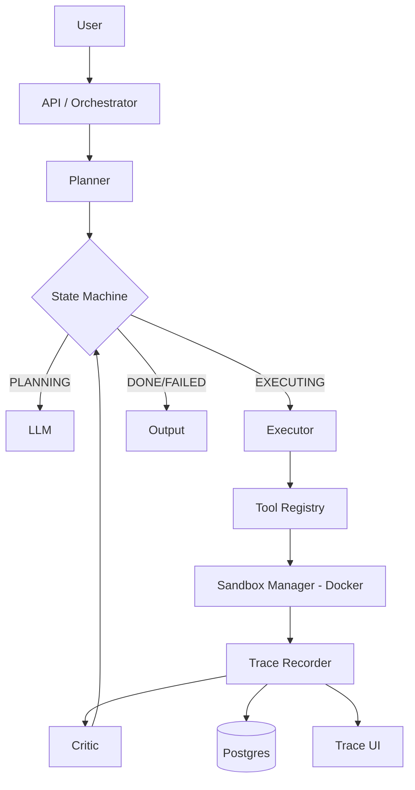

# Agent Platform - Architecture v0

## 1. Flow
Task -> Planner -> Executor -> Tool Sandbox (Docker) -> Critic -> Loop -> Final Output



## Trace schema 
```
{
  "run_id": "uuid",
  "task": "string",
  "steps": [
    {
      "step_id": 1,
      "type": "plan|tool_call|llm_call|critique|revision",
      "input": {},
      "output": {},
      "tokens": {"in": 0, "out": 0},
      "latency_ms": 0,
      "cost_usd": 0.0,
      "parent_step_id": null
    }
  ],
  "status": "succeeded|failed|timeout",
  "final_output": {}
}
```